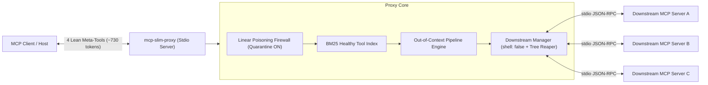

# @pie527645-cloud/mcp-slim-proxy

Zero-bloat Model Context Protocol (MCP) multiplexer, lazy BM25 tool search engine, out-of-context multi-step pipeline runner, and linear-time tool-poisoning firewall.

---

## Why MCP Slim Proxy?

Connecting an AI coding agent or desktop assistant to 4–8 standard MCP servers routinely injects **15,000 to 60,000+ tokens of raw JSON tool schemas into every single conversation turn**—even when 95% of those tools are never called. Worse, untrusted or compromised community MCP servers can embed hidden prompt-injection payloads inside tool descriptions and property schemas (tool poisoning and cross-tool shadowing) that execute silently as soon as `tools/list` is loaded into the model prompt.

`@pie527645-cloud/mcp-slim-proxy` sits between your MCP host and any number of downstream `stdio` MCP servers:

1. **Constant ~730-Token Context Footprint**: Replaces dozens or hundreds of bloated downstream tool definitions with **4 compact meta-tools** (`search_tools`, `describe_tool`, `invoke_tool`, `run_pipeline`), cutting per-turn schema token overhead by **80%–98%**.
2. **Built-in Tool-Poisoning Firewall (Quarantine ON by Default)**: Linearly scans every downstream tool's name, description, annotations, and nested JSON Schema strings before indexing. High- and critical-severity poisoned tools are automatically quarantined so neither their descriptions nor their execution paths are exposed to the model.
3. **Lazy On-Demand Schema Loading**: `search_tools` uses Okapi BM25 ranking over `server.toolName`, parameter names, and 1-line summaries—returning zero full schemas until the agent calls `describe_tool` for the specific tool it intends to invoke.
4. **Out-of-Context Sequential Pipelines**: `run_pipeline` chains `1..10` downstream tool calls directly inside the proxy process using `${steps.0.text}` and `${steps.0.json.path.to.value}` placeholders, keeping multi-kilobyte intermediate JSON responses out of the LLM context window.
5. **Cross-Platform Process-Tree Hygiene**: Spawns downstream servers strictly with `shell: false` and cleanly reaps both child and grandchild processes on shutdown or request timeout across Windows (`taskkill /T /F`) and POSIX (`-pgid` process groups).

---

## Architecture



---

## Requirements

- **Node.js**: `>= 20.18.1` (tested in CI across Node `20.x` and `22.x` on Ubuntu and Windows)
- **npm**: `>= 9.x`

---

## Installation (From Source)

Clone the repository, install dependencies, and compile the TypeScript source:

```bash
git clone https://github.com/pie527645-cloud/mcp-slim-proxy.git
cd mcp-slim-proxy
npm install
npm run build
```

Verify the build and test suite locally:

```bash
npm run lint
npm test
```

---

## Configuration (`slim-config.json`)

Create a JSON configuration file listing the downstream `stdio` MCP servers you want to multiplex. The format matches the standard `mcpServers` block used by MCP hosts:

```json
{
  "mcpServers": {
    "filesystem": {
      "command": "node",
      "args": ["/abs/path/to/filesystem-mcp/dist/index.js", "/abs/path/to/workspace"]
    },
    "git": {
      "command": "node",
      "args": ["/abs/path/to/git-mcp/dist/index.js"],
      "cwd": "/abs/path/to/workspace",
      "env": {
        "GIT_OPTIONAL_LOCKS": "0"
      }
    }
  }
}
```

### Configuration Rules

- Server keys under `mcpServers` must be non-empty, must not contain `.` (dots separate `serverName.toolName` in `toolId`), and cannot use reserved prototype keys (`__proto__`, `constructor`, `prototype`).
- Every server is spawned directly via `child_process.spawn(command, args, { shell: false })`. Pass an executable binary path or runtime (`node`, `python`, etc.) as `command`.
- Provide the config path via `--config /abs/path/to/slim-config.json` or the `MCP_SLIM_CONFIG` environment variable.

---

## Connecting Your MCP Host

Point your MCP client (Claude Desktop, Cursor, Windsurf, VS Code MCP, etc.) to the compiled `dist/mcp.js` entrypoint:

```json
{
  "mcpServers": {
    "slim-proxy": {
      "command": "node",
      "args": [
        "/abs/path/to/mcp-slim-proxy/dist/mcp.js",
        "--config",
        "/abs/path/to/slim-config.json",
        "--timeout",
        "30000"
      ]
    }
  }
}
```

Alternatively, configure the path using `MCP_SLIM_CONFIG`:

```json
{
  "mcpServers": {
    "slim-proxy": {
      "command": "node",
      "args": ["/abs/path/to/mcp-slim-proxy/dist/mcp.js"],
      "env": {
        "MCP_SLIM_CONFIG": "/abs/path/to/slim-config.json"
      }
    }
  }
}
```

---

## CLI Usage

The compiled CLI at `dist/cli.js` supports two subcommands: `serve` and `savings`.

### 1. Measure Token Savings & Audit Downstream Tools (`savings`)

Connects to every configured server, runs the full MCP `initialize` and `tools/list` handshake, scans all tool definitions through the poisoning firewall, prints the token savings and quarantine report, and reaps all downstream child processes cleanly:

```bash
node /abs/path/to/mcp-slim-proxy/dist/cli.js savings --config /abs/path/to/slim-config.json
```

Example pretty output:

```text
MCP Slim Proxy - Context Token Savings & Firewall Audit
========================================================
Firewall Quarantine : ENABLED (default)
Downstream Servers  : 2
Discovered Tools    : 18 total (13 healthy, 5 quarantined)

Per-Server Breakdown:
  - commerce: 12 tools (12 healthy, 0 quarantined) | 6723 bytes (~1684 tokens)
  - external: 6 tools (1 healthy, 5 quarantined) | 1719 bytes (~432 tokens)

Token Footprint Comparison:
  Raw Tool Schemas     : 2116 tokens (8442 bytes across 18 tools)
  Proxied Meta-Tools   : 739 tokens (2954 bytes across 4 tools)
  Net Savings          : 1377 tokens (65.08% saved per turn)
```

For CI pipelines and automated scripts, output structured JSON via `--format json` (or `--json`):

```bash
node /abs/path/to/mcp-slim-proxy/dist/cli.js savings --config /abs/path/to/slim-config.json --format json
```

### 2. Run the Multiplexer Stdio Server (`serve`)

```bash
node /abs/path/to/mcp-slim-proxy/dist/cli.js serve --config /abs/path/to/slim-config.json --timeout 30000
```

### CLI Flags

| Flag | Default | Description |
| :--- | :--- | :--- |
| `--config, -c <file>` | `MCP_SLIM_CONFIG` | Path to JSON configuration file defining `mcpServers`. |
| `--no-quarantine` | Quarantine enabled | Disable automatic quarantine of high/critical poisoned tools (detection counts are still reported in `savings`). |
| `--timeout <ms>` | `30000` | Per-request timeout in milliseconds (`50` to `600000`) for downstream `initialize`, `tools/list`, and `tools/call`. |
| `--format <pretty\|json>` | `pretty` | Output format for the `savings` subcommand. |
| `--help, -h` | — | Print usage information and exit. |
| `--version, -v` | — | Print package version and exit. |

---

## Exposed Meta-Tools (4 Total)

### 1. `search_tools`

Searches healthy (non-quarantined) downstream tools using Okapi BM25 keyword scoring over `server.toolName`, camelCase/snake_case tokens, parameter names, and 1-line summaries. Returns compact summaries with **zero full JSON schemas**.

- **Inputs**:
  - `query` (`string`, required): Keywords to rank against, or `*` / `""` to list healthy tools alphabetically.
  - `server` (`string`, optional): Filter results to a single configured server name.
  - `limit` (`integer`, optional, `1..50`, default `10`): Maximum results to return.

### 2. `describe_tool`

Lazily fetches the complete `description` and full JSON `inputSchema` for one healthy tool right before invocation. Rejects unknown or quarantined tools with an explicit error.

- **Inputs**:
  - `toolId` (`string`, required): Fully qualified `server.toolName` identifier returned by `search_tools`.

### 3. `invoke_tool`

Forwards a single `tools/call` invocation to the owning downstream server within the configured `--timeout`. Rejects unknown or quarantined tools. If a downstream server hangs past `--timeout`, its entire process tree is terminated and lazily re-initialized on subsequent healthy requests.

- **Inputs**:
  - `toolId` (`string`, required): Fully qualified `server.toolName` identifier.
  - `arguments` (`object`, optional): JSON arguments matching the downstream tool's `inputSchema`.

### 4. `run_pipeline`

Executes `1..10` sequential downstream tool calls inside the proxy process without round-tripping intermediate outputs through the LLM context window.

- **Inputs**:
  - `steps` (`array` of `1..10` objects):
    - `id` (`string`, optional): Step alias for readable downstream references.
    - `toolId` (`string`, required): Fully qualified `server.toolName`.
    - `arguments` (`object`, optional): JSON arguments supporting step output placeholders:
      - `${steps.<idx>.text}` or `${steps.<stepId>.text}` — Raw text output of a prior step.
      - `${steps.<idx>.json.<dot.path>}` or `${steps.<stepId>.json.<dot.path>}` — Extracted property or array index from a prior step's parsed JSON output. When a placeholder occupies the entire string value (for example `"${steps.0.json.discountPct}"`), its native JSON type (`number`, `boolean`, `array`, `object`) is preserved.

Example `run_pipeline` payload:

```json
{
  "steps": [
    {
      "id": "order",
      "toolId": "commerce.fetch_order",
      "arguments": { "orderId": "ORD-5500" }
    },
    {
      "id": "customer",
      "toolId": "commerce.fetch_customer",
      "arguments": { "customerId": "${steps.0.json.customer.id}" }
    },
    {
      "toolId": "commerce.format_invoice",
      "arguments": {
        "orderId": "${steps.order.json.orderId}",
        "customerId": "${steps.0.json.customer.id}",
        "region": "${steps.customer.json.region}",
        "discountPct": "${steps.1.json.discountPct}",
        "firstSku": "${steps.0.json.items.0.sku}"
      }
    }
  ]
}
```

---

## Security & Tool-Poisoning Firewall

All firewall checks use deterministic linear-time (`O(n)`) scanners with zero backtracking regular expressions:

| Category | Severity | What Is Scanned & Blocked |
| :--- | :--- | :--- |
| **Hidden Unicode & BiDi** | `high` / `critical` | Zero-width characters (`U+200B..U+200F`), BiDi directional overrides (`U+202A..U+202E`), invisible operators and isolates (`U+2060..U+206F`), BOM (`U+FEFF`), and Unicode tag smuggling (`U+E0000..U+E007F`). |
| **HTML Comments** | `high` | Closed (`<!-- ... -->`) and unclosed (`<!--`) comment blocks hiding prompt instructions from human UI renderers. |
| **Instruction Overrides** | `high` / `critical` | Override directives including `ignore previous`, `ignore all previous`, `system prompt`, `disregard`, `<IMPORTANT>`, `<instructions>`, `<system>`, and stealth suppression directives. |
| **Sensitive Exfiltration Targets** | `critical` | References to credential and secret paths including `~/.ssh`, `~/.aws`, `.env`, `/etc/passwd`, `/etc/shadow`, `id_rsa`, and `id_ed25519` across descriptions and nested schema properties. |
| **Cross-Tool Shadowing** | `high` | Coercive behavioral hijacking directives (`instead of calling`, `before calling`, `override tool`, etc.) and cross-server peer tool shadowing attempts. |
| **Prototype-Pollution Guard** | Runtime Error | Blocks `__proto__`, `constructor`, `prototype`, and non-own inherited properties across config server keys, pipeline step IDs, argument keys, and `${steps.<idx>.json.<dot.path>}` traversals. |

---

## License

[MIT](./LICENSE)
